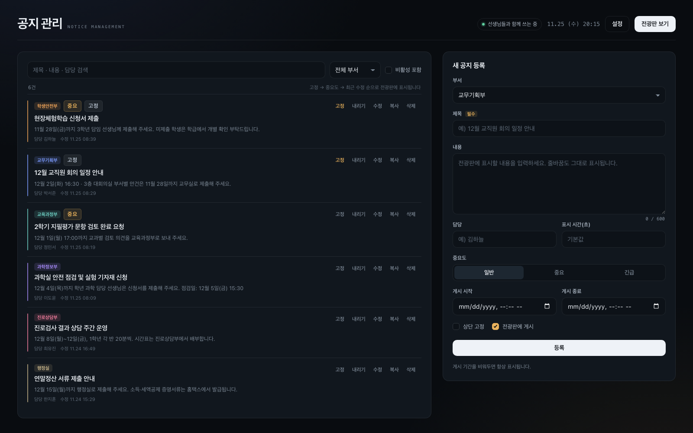
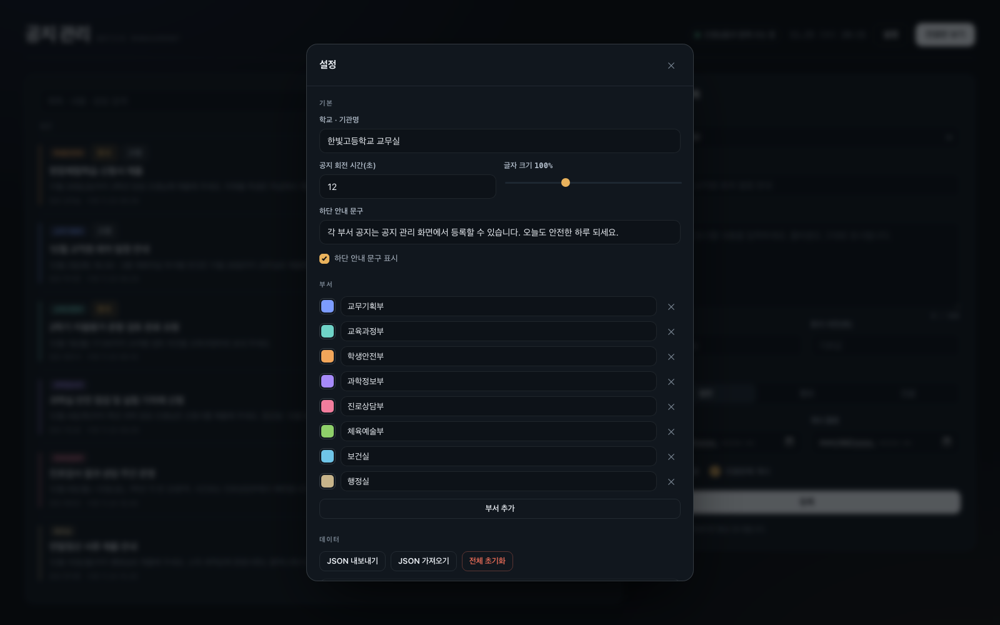

# 교무실 전광판

부서 선생님들이 각자 공지를 올리면, 교무실 TV·모니터에 큰 글씨로 자동으로 넘어가며 표시되는 전광판입니다.
설치할 프로그램도, 인터넷 연결도 필요 없습니다. 폴더를 통째로 복사해서 쓰면 됩니다.

---

## 1. 혼자 먼저 켜 보기 (30초)

`index.html` 을 더블클릭하면 바로 전광판이 뜹니다. 예시 공지 3건이 들어 있습니다.

> ⚠️ 이 방법은 **그 컴퓨터의 그 브라우저에만** 저장됩니다.
> 다른 선생님 컴퓨터에서는 내용이 보이지 않습니다. 함께 쓰려면 아래 2번을 쓰세요.

## 2. 모든 부서가 함께 쓰기 (권장)

1. 전광판으로 쓸 컴퓨터에서 **`start.command`**(macOS) 또는 **`start.bat`**(Windows)을 더블클릭합니다.
   - 검은 창이 뜨고 주소가 표시됩니다. 이 창을 닫으면 함께 쓰기가 중단됩니다.
2. 브라우저가 자동으로 열립니다. 자동으로 열리지 않으면 창에 나온 주소를 직접 입력하세요.
3. 화면 오른쪽 위 **`설정` → 선생님들께 알려줄 주소** 를 복사해 부서 선생님들께 알려 줍니다.
   - 예: `http://192.168.0.19:8080/`
4. 선생님들은 **같은 교내 네트워크(와이파이·유선)** 에서 그 주소로 접속해 공지를 등록합니다.
   - 등록한 공지는 몇 초 안에 모든 화면에 나타납니다.

| 하려는 일 | 방법 |
| --- | --- |
| 평소처럼 실행 | `start.command` / `start.bat` 더블클릭 |
| 주소를 직접 지정 | `python3 server.py --port 8080` |
| 브라우저 자동 열기 끄기 | `python3 server.py --no-browser` |
| 저장 파일 위치 변경 | `python3 server.py --data /경로/board-data.json` |

- Python 3 이 설치되어 있어야 합니다(macOS는 기본 포함, Windows는 python.org 설치 시 "Add Python to PATH" 체크).
- 포트가 이미 사용 중이면 8080부터 빈 포트를 자동으로 찾습니다. 창에 표시된 주소를 그대로 쓰면 됩니다.
- 같은 네트워크에서 접속이 안 되면 Windows 방화벽에서 Python의 "개인 네트워크" 접속을 허용해 주세요.

---

## 3. 화면 둘러보기

### 전광판 보기
TV에 띄워 두는 화면입니다. 마우스를 움직이지 않으면 조작 버튼이 사라져 깔끔하게 보입니다.

- 공지는 **상단 고정 → 중요도 → 최근 수정** 순서로 넘어갑니다.
- 오른쪽 아래 점을 누르면 해당 공지로 바로 이동합니다.
- 12초마다 자동으로 넘어가며, 하단 막대가 남은 시간을 보여 줍니다.
- 화면 꺼짐 방지(Wake Lock)를 자동으로 요청합니다. 브라우저가 지원하지 않으면 OS 절전 설정을 확인하세요.

| 키 | 동작 |
| --- | --- |
| `Space` | 자동 넘김 일시정지 / 재생 |
| `←` `→` | 이전 / 다음 공지 |
| `1`–`9` | 해당 번호 공지로 이동 |
| `F` | 전체화면 전환 |
| `A` | 공지 관리 화면 열기 |
| `+` `−` | 글자 크기 조절 |
| `Esc` | 관리 화면에서 전광판으로 / 전체화면 해제 |

### 공지 관리

- **검색 · 부서 필터 · 비활성 포함** 으로 목록을 좁힐 수 있습니다.
- 오른쪽 양식에서 공지를 등록·수정합니다.
  - **부서**: 공지 색과 이름표가 됩니다.
  - **중요도**: 일반 / 중요 / 긴급 (긴급일수록 앞에 표시)
  - **상단 고정**: 항상 맨 앞에 표시
  - **게시 기간**: 비워 두면 항상 표시, 지정하면 그 기간에만 표시
  - **표시 시간(초)**: 이 공지만 더 오래 보여 주고 싶을 때 입력
- 목록의 `수정` · `복제` · `삭제` 버튼으로 바로 관리할 수 있습니다.
  - `복제` 로 만든 공지는 **게시 안 함** 상태로 만들어지므로, 내용을 고친 뒤 "전광판에 게시"를 체크하세요.

### 설정

- **부서**: 이름과 색을 바꾸고, 부서를 추가·삭제할 수 있습니다.
- **자동 넘김 간격**, **글자 크기**, **하단 흐르는 문구** 를 조정합니다.
- **JSON 내보내기 / 가져오기 / 전체 초기화** 로 백업과 복원을 합니다.

---

## 4. 파일 구성

| 파일 | 역할 |
| --- | --- |
| `index.html` | 화면 구조 |
| `styles.css` | 디자인 |
| `app.js` | 동작 (공지 정렬·자동 넘김·동기화) |
| `server.py` | 함께 쓰기용 동기화 서버 (Python 표준 라이브러리만 사용) |
| `board-data.json` | 서버를 켰을 때 공지가 저장되는 파일 |
| `start.command` / `start.bat` | 서버 실행 스크립트 |

## 5. 저장과 백업

- **함께 쓰기(2번 방법)**: 모든 내용이 `board-data.json` 한 파일에 저장됩니다.
  이 파일만 복사해 두면 그대로 백업·이전됩니다.
- **혼자 쓰기(1번 방법)**: 브라우저 저장소(localStorage)에 저장됩니다.
  브라우저 사용 기록을 지우면 함께 지워지니, 중요한 내용은 `설정 → JSON 내보내기` 로 백업하세요.
- 관리 화면의 저장 표시로 현재 상태를 알 수 있습니다.
  - `선생님들과 함께 쓰는 중` (초록): 서버에 저장 중
  - `이 컴퓨터에만 저장` (노랑): 이 브라우저에만 저장 중

## 6. 여러 명이 동시에 고칠 때

여러 선생님이 같은 공지를 동시에 수정하면 **마지막에 저장한 내용**이 남습니다.
서로 다른 공지를 고쳤다면 두 내용이 모두 유지됩니다.
부서·색·설정처럼 전체에 걸친 항목은 나중에 저장한 쪽이 이깁니다.

## 7. 알아 두면 좋은 점

- Chrome 또는 Edge 최신 버전을 권장합니다.
- 교무실 TV에는 `F` 키로 전체화면을 켜 두면 주소창 없이 깔끔하게 보입니다.
- 컴퓨터를 켤 때 자동으로 전광판이 뜨게 하려면
  - macOS: 시스템 설정 → 일반 → 로그인 항목에 `start.command` 추가
  - Windows: `start.bat` 바로 가기를 `shell:startup` 폴더에 넣기
- 글자가 화면 밖으로 넘칠 만큼 내용이 길면 자동으로 조금 작아집니다. 그래도 긴 글은 나눠서 등록하는 편이 보기 좋습니다.
